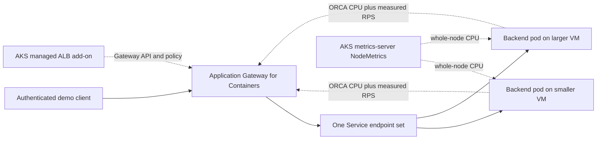

# One native L7 gateway, heterogeneous node endpoints

The Service identifies eligible pod endpoints; the gateway connects directly to those
endpoints. It does **not** send requests through a kube-proxy round-robin hop, or
route directly to VMSS instances. A DaemonSet places exactly one backend per selected
node so each endpoint's CPU report belongs to its host VM.
